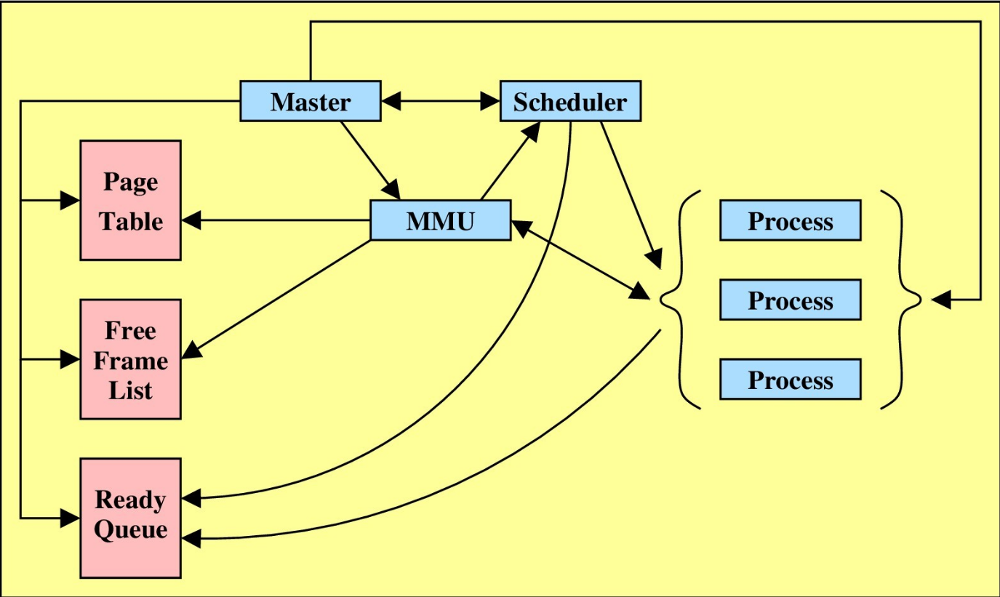
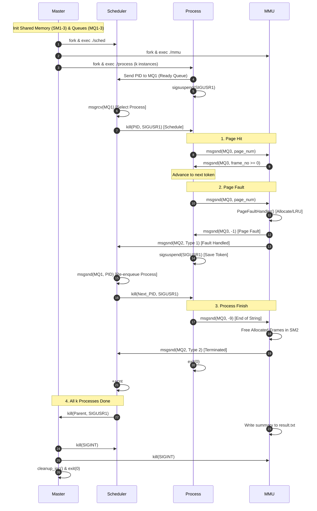

# Virtual Memory Simulation via (Pure) Demand Paging

A complete, multiprocess simulation of an operating system virtual memory manager written in C. This project simulates **Pure Demand Paging** with **Local Least Recently Used (LRU)** page replacement, **First-Come First-Served (FCFS)** process scheduling, and System V IPC (Shared Memory and Message Queues).

Originally based on IIT Kharagpur's **CS39002: Operating Systems Laboratory** ([Lab Assignment 8](LA8.pdf)).

---

## Table of Contents

1. [Overview](#overview)
2. [High-Level Architecture](#high-level-architecture)
3. [Inter-Process Communication (IPC) & Data Structures](#inter-process-communication-ipc--data-structures)
   - [Shared Memory Segments](#shared-memory-segments)
   - [Message Queues](#message-queues)
   - [Signals & Synchronization](#signals--synchronization)
4. [Algorithms & Policies](#algorithms--policies)
   - [Pure Demand Paging](#pure-demand-paging)
   - [Local LRU Page Replacement](#local-lru-page-replacement)
   - [FCFS Process Scheduling](#fcfs-process-scheduling)
   - [Reference String Generation](#reference-string-generation)
5. [End-to-End Control Flow](#end-to-end-control-flow)
   - [1. System Initialization](#1-system-initialization)
   - [2. Process Execution Loop](#2-process-execution-loop)
   - [3. Memory Access Scenarios](#3-memory-access-scenarios)
     - [Scenario A: Page Hit](#scenario-a-page-hit)
     - [Scenario B: Page Fault with Free Frame](#scenario-b-page-fault-with-free-frame)
     - [Scenario C: Page Fault with Local LRU Eviction](#scenario-c-page-fault-with-local-lru-eviction)
     - [Scenario D: Invalid Page Reference (Segmentation Fault)](#scenario-d-invalid-page-reference-segmentation-fault)
     - [Scenario E: Process Completion (`-9`)](#scenario-e-process-completion--9)
   - [4. System Teardown](#4-system-teardown)
6. [Sequence Diagram](#sequence-diagram)
7. [Bugs Identified & Fixes Implemented](#bugs-identified--fixes-implemented)
8. [Build & Execution Guide](#build--execution-guide)
9. [Sample Output & Log Format](#sample-output--log-format)

---

## Overview

In modern multiprogramming operating systems, virtual memory abstracts physical DRAM, allowing processes to execute without requiring their entire address space to reside in physical memory at once.

This project simulates:
- **Multiprogramming & Concurrency**: Spawns $k$ distinct client processes running alongside an independent CPU Scheduler and Memory Management Unit (MMU).
- **Pure Demand Paging**: Pages are brought into physical frames strictly on demand when referenced.
- **Hardware Memory Management Unit (MMU)** emulation: Translates virtual page numbers to physical frame numbers using page tables.
- **I/O Page-In & Preemption**: When a page fault occurs, the CPU scheduler context-switches the faulting process out, allowing another ready process to execute while the MMU handles the fault.
- **Local LRU Eviction**: When a process exhausts its allocated physical frames and no free frames exist, the MMU identifies and evicts the least recently used page belonging to *that specific process*.
- **Segmentation Fault Handling**: Detects out-of-bounds page requests, immediately terminates the offending process, releases its allocated frames, and notifies the scheduler.

---

## High-Level Architecture

The system consists of **4 modules** running as separate concurrent processes:

```
                           +-------------------+
                           |      Master       |
                           +-------------------+
                             /       |       \
                   fork/exec/  fork/exec/     \fork/exec
                           v         |         v
              +---------------+      |      +------------------+
              |   Scheduler   |      |      |       MMU        |
              +---------------+      |      +------------------+
                     ^               |         ^            ^
                     | (MQ1, MQ2)    |         | (MQ3)      | (SM1, SM2, SM3)
                     v               v         v            v
             +-------------------------------------------------+
             |             Client Processes (P1 .. Pk)         |
             +-------------------------------------------------+
```



| Module | Source File | Responsibilities |
|---|---|---|
| **Master** | [`Master.c`](Master.c) | - Prompts user for inputs: $k$ (processes), $m$ (virtual address space), $f$ (physical frames).<br>- Creates shared memory segments (`SM1`, `SM2`, `SM3`) and message queues (`MQ1`, `MQ2`, `MQ3`).<br>- Initializes page tables and free frame lists.<br>- Forks and executes `Scheduler`, `MMU`, and $k$ `Process` instances (at 250 ms intervals).<br>- Waits for completion signal from Scheduler, terminates MMU & Scheduler, and cleanly removes all IPC resources. |
| **Scheduler** | [`sched.c`](sched.c) | - Implements First-Come First-Served (FCFS) process scheduling.<br>- Blocks on Ready Queue (`MQ1`).<br>- Signals front process via `SIGUSR1` to allocate CPU.<br>- Waits on `MQ2` for MMU notification (`Type 1`: Page Fault Handled $\implies$ re-enqueue; `Type 2`: Process Terminated $\implies$ advance count).<br>- Notifies Master via `SIGUSR1` when all $k$ processes terminate. |
| **MMU** | [`MMU.c`](MMU.c) | - Listens on `MQ3` for page requests from active processes.<br>- Performs page table lookups (`SM1`) and checks bounds against process page limits (`SM3`).<br>- Handles Page Faults: assigns free frames (`SM2`) or evicts local victim via LRU.<br>- Sends translated frame number, `-1` (page fault), or `-2` (illegal access) back to process.<br>- Sends status to Scheduler via `MQ2`.<br>- Writes chronological logs to console and `result.txt`. |
| **Process** | [`process.c`](process.c) | - Enqueues its PID into Ready Queue (`MQ1`) and suspends execution.<br>- Upon receiving `SIGUSR1` from Scheduler, parses comma-separated reference string.<br>- Sends page numbers to MMU via `MQ3` and waits for translation.<br>- Advances on hit; suspends on fault (`-1`) until rescheduled; exits on invalid access (`-2`).<br>- Sends `-9` sentinel to MMU upon completing reference string. |

---

## Inter-Process Communication (IPC) & Data Structures

### Shared Memory Segments

| Segment | Key Identifier | Type / Struct | Size | Description |
|---|---|---|---|---|
| **SM1** | `ftok("/tmp", 100)` | `pageTable[k * m]` | $k \times m \times \text{sizeof(pageTable)}$ | Array of per-process page tables. Entry $[i \cdot m + j]$ represents process $i$, page $j$:<br>`int valid`: `1` if in memory, `0` otherwise.<br>`int frame_no`: Physical frame number (or `-1` if unmapped). |
| **SM2** | `ftok("/tmp", 101)` | `int[f]` | $f \times \text{sizeof(int)}$ | Free Frame List:<br>`1` = frame is free / unallocated.<br>`0` = frame is currently occupied. |
| **SM3** | `ftok("/tmp", 102)` | `pageMap[k]` | $k \times \text{sizeof(pageMap)}$ | Process metadata table:<br>`int pid`: PID of process $i$.<br>`int num_page`: Actual virtual pages $m_i \in [1, m]$ allocated to process $i$. |

### Message Queues

| Queue | Key Identifier | Direction | Message Format | Description |
|---|---|---|---|---|
| **MQ1** | `ftok("/tmp", 103)` | Process $\to$ Scheduler | `struct { long m_type; struct { int pid; } message; }` | **Ready Queue**: Holds PIDs of ready processes waiting for CPU allocation in FCFS order (`m_type = 1`). |
| **MQ2** | `ftok("/tmp", 104)` | MMU $\to$ Scheduler | `struct { long m_type; int message; }` | **Scheduler Sync Queue**: Informs scheduler of memory events (`m_type = 1`):<br>`message = 1`: Type I (Page fault handled, re-enqueue process).<br>`message = 2`: Type II (Process terminated or fault exit, do not re-enqueue). |
| **MQ3** | `ftok("/tmp", 105)` | Process $\leftrightarrow$ MMU | `struct { long m_type; struct { int pid; int data; } message; }` | **MMU Service Queue**:<br>- **Process $\to$ MMU** (`m_type = 1`): `pid` = process PID, `data` = requested page number (or `-9` for EOF).<br>- **MMU $\to$ Process** (`m_type = pid`): `data` = physical frame number ($\ge 0$), `-1` (page fault), or `-2` (segmentation fault). |

### Signals & Synchronization

- **`SIGUSR1`**:
  - `Scheduler -> Process`: Wakes up the scheduled process to start/resume execution.
  - `Scheduler -> Master`: Notifies Master that all $k$ processes have completed.
- **`SIGINT`**: Sent by Master to cleanly terminate MMU and Scheduler child processes upon completion or keyboard interrupt.
- **`sigsuspend` / `sigprocmask`**: Eliminates signal race conditions during process suspension, ensuring atomic signal unmasking and wait.

---

## Algorithms & Policies

### Pure Demand Paging
1. Each process begins execution with only a proportional initial allocation of frames.
2. A page is never loaded into physical RAM until the CPU explicitly generates a memory reference to that page.
3. If the page is marked `valid == 0` in the process's page table, a **Page Fault** is triggered.

### Local LRU Page Replacement
When a page fault occurs for process $p_i$:
1. **Free Frame Check**: MMU inspects `SM2` (`free_frame_list`). If any frame $f_x$ has value `1`, frame $f_x$ is allocated:
   - `page_table[p_i * m + page_num].frame_no = f_x`
   - `page_table[p_i * m + page_num].valid = 1`
   - `free_frame_list[f_x] = 0`
   - `pageTimeStamp[p_i][page_num] = timestamp`
2. **Local Eviction (LRU)**: If no free frame exists in physical memory, MMU selects a victim page among pages currently belonging to process $p_i$:
   $$\text{victim} = \arg\max_{0 \le j < m,\; \text{valid}_j = 1} \left( \text{timestamp} - \text{pageTimeStamp}[p_i][j] \right)$$
   - The victim page's frame is reassigned to the requested page.
   - Victim's `valid` bit is set to `0`, `frame_no` set to `-1`, and timestamp reset to `-1`.
   - New page's `valid` bit is set to `1` and timestamp set to current global `timestamp`.
   - **Local Scope Isolation**: Process $A$ can never evict a frame allocated to Process $B$.

### FCFS Process Scheduling
- Scheduler maintains a strict First-Come, First-Served queue via `MQ1`.
- A process runs on the virtual CPU until:
  - It generates a **page fault**: MMU handles the fault, sends Type I message to scheduler, and scheduler pushes the process to the back of the ready queue.
  - It encounters an **illegal page reference**: MMU sends Type II message; process terminates.
  - It reaches the **end of its reference string**: Process sends `-9`; MMU sends Type II message; process terminates.

### Reference String Generation
For each process $p_i$:
- Allocates $m_i \in [1, m]$ pages. Legal pages are $[0, m_i - 1]$.
- Reference string length $x \in [2 \cdot m_i, 10 \cdot m_i]$.
- Each reference generates a legal page number $[0, m_i - 1]$ with probability $1 - \text{prob}$ ($95\%$).
- With probability $\text{prob} = 0.05$ ($5\%$), an illegal page number $m_i$ is injected to simulate a segmentation fault.

---

## End-to-End Control Flow

```
                      MASTER INITIALIZATION
                               |
              +----------------+----------------+
              |                                 |
      Create Shared Memory             Create Message Queues
     (SM1: Page Tables)                (MQ1: Ready Queue)
     (SM2: Free Frame List)            (MQ2: Sched-MMU Sync)
     (SM3: Process Map Table)          (MQ3: Process-MMU)
              |                                 |
              +----------------+----------------+
                               |
                        Fork Scheduler
                               |
                         Fork MMU (xterm / console)
                               |
                 Fork k Processes (250ms spacing)
                               |
                Master waits on Scheduler signal
```

### 1. System Initialization
1. User enters $k$ (processes), $m$ (max pages per process), $f$ (physical frames).
2. Master allocates and initializes `SM1`, `SM2`, `SM3` and `MQ1`, `MQ2`, `MQ3`.
3. Master forks `Scheduler` (`./sched MQ1 MQ2 k`).
4. Master forks `MMU` (first attempts inside `xterm`, falls back to direct execution if headless).
5. Master assigns each process $i$ a random page size $m_i \in [1, m]$ and calculates proportional frames:
   $$\text{num\_frames}_i = \left\lfloor \frac{m_i \cdot f}{\sum m_i} \right\rfloor$$
   Assigns frames proportionally to page tables and marks them valid.
6. Master spawns $k$ client processes at 250 ms intervals, passing `MQ1`, `MQ3`, and the reference string.

### 2. Process Execution Loop
1. Process registers its PID in `MQ1` and enters atomic wait state (`sigsuspend`).
2. Scheduler pulls the next process PID from `MQ1` (FCFS) and sends `SIGUSR1`.
3. Process wakes up and iterates through tokens in its reference string:
   - Dispatches page number request to MMU via `MQ3` (`m_type = 1`).
   - Blocks waiting for response on `MQ3` with `m_type = pid`.

### 3. Memory Access Scenarios

#### Scenario A: Page Hit
- **Condition**: Page table entry has `valid == 1`.
- **MMU Action**: Updates `pageTimeStamp[p_i][page_num] = timestamp`.
- **MMU Response**: Sends `frame_no` back to process via `MQ3`.
- **Process Action**: Receives valid frame number ($\ge 0$); advances `strtok` to next token; continues without yielding CPU.

#### Scenario B: Page Fault with Free Frame
- **Condition**: Page table entry has `valid == 0` and at least one free frame exists in `SM2`.
- **MMU Action**:
  1. Logs page fault sequence to stdout and `result.txt`.
  2. Allocates free frame $i$, marks `valid = 1`, clears free bit in `SM2`, and records timestamp.
  3. Sends `-1` to process via `MQ3`.
  4. Sends Type I message (`1`) to Scheduler via `MQ2`.
- **Scheduler Action**: Receives Type I message; re-enqueues current process PID to back of `MQ1`; schedules next process.
- **Process Action**: Receives `-1`; saves current token position; enters `sigsuspend` waiting for Scheduler to reschedule. Upon wake-up, repeats the memory access (which is now a Page Hit).

#### Scenario C: Page Fault with Local LRU Eviction
- **Condition**: Page table entry has `valid == 0` and no free frames remain in `SM2`.
- **MMU Action**:
  1. Finds victim page $j$ of process $p_i$ with maximum $(timestamp - \text{pageTimeStamp}[p_i][j])$.
  2. Invalidates victim: `valid = 0`, `frame_no = -1`, `pageTimeStamp = -1`.
  3. Reassigns victim's frame to requested page: `valid = 1`, updates timestamp.
  4. Sends `-1` to process via `MQ3` and Type I to Scheduler via `MQ2`.

#### Scenario D: Invalid Page Reference (Segmentation Fault)
- **Condition**: Process requests $page\_num \ge m_i$ or $page\_num < 0$.
- **MMU Action**:
  1. Prints `Invalid page reference - (process_num, page_num)` to console and `result.txt`.
  2. Sends `-2` to process via `MQ3`.
  3. Frees all physical frames currently allocated to this process in `SM2`.
  4. Sends Type II message (`2`) to Scheduler via `MQ2`.
  5. Increments `cnt` of finished processes.
- **Process Action**: Receives `-2` and immediately exits (`exit(0)`).

#### Scenario E: Process Completion (`-9`)
- **Condition**: Process finishes scanning its reference string and sends sentinel `-9` to MMU.
- **MMU Action**:
  1. Reclaims all frames allocated to this process, marking them free in `SM2` and invalid in `SM1`.
  2. Sends Type II message (`2`) to Scheduler via `MQ2`.
  3. Increments finished process count `cnt`.
- **Process Action**: Terminates cleanly with `exit(0)`.

### 4. System Teardown
1. When Scheduler counts $k$ completed processes (`cnt == k`), it signals Master with `kill(getppid(), SIGUSR1)` and pauses.
2. Master wakes up from `sigsuspend`.
3. MMU prints per-process statistics (Page Fault count and Invalid Access count) to console and `result.txt`, closes files, detaches shared memories, and pauses.
4. Master sends `SIGINT` to Scheduler and MMU.
5. Master reaps all zombie child processes (`waitpid`).
6. Master destroys all Shared Memory segments (`SM1`, `SM2`, `SM3`) and Message Queues (`MQ1`, `MQ2`, `MQ3`).
7. Master exits cleanly.

---

## Sequence Diagram



---

## Bugs Identified & Fixes Implemented

During code audit and cross-verification against [`LA8.pdf`](LA8.pdf), several bugs and edge cases were identified and corrected:

| # | File | Bug Description | Impact | Fix Applied |
|---|---|---|---|---|
| **1** | [`MMU.c`](MMU.c) | **Unrecorded timestamp in free frame allocation** (`PageFaultHandler` returned after finding a free frame without updating `pageTimeStamp[p_i][page_num]`). | Newly loaded pages retained timestamp `-1`. When physical memory filled up, $\text{diff} = \text{timestamp} - (-1)$ was maximum, causing freshly loaded pages to be immediately evicted on the very next fault! | Added `pageTimeStamp[p_i][page_num] = timestamp;` prior to returning from free frame allocation. |
| **2** | [`process.c`](process.c) | **Premature reference string token skip on page fault** (`token = strtok(NULL, ",");` was called inside `else if (pgf_msg.message.data == -1)`). | Skipped the page that caused the fault! The brought-in page was never accessed; process skipped straight to the next page, inducing artificial fault storms. | Removed token advancement on `-1`. Upon rescheduling, the process retries the same page reference (which now hits). |
| **3** | [`process.c`](process.c), [`Master.c`](Master.c) | **Signal race condition / Lost Wakeup** (`pause()` called after checking `signal_msg == 0` without blocking signals). | If `SIGUSR1` arrived between condition check and `pause()`, signal handler ran and `pause()` hung indefinitely. | Replaced with atomic `sigprocmask()` + `sigsuspend()` loop. |
| **4** | [`Master.c`](Master.c) | **Missing error handling on `execlp` failure**. | If `xterm`, `sched`, or `process` failed to execute, child process fell through and executed Master's main loop, creating duplicate masters and fork cascades. | Added `perror()` and `exit(1)` after every `execlp()`. |
| **5** | [`Master.c`](Master.c) | **Hard dependency on `xterm`**. | On systems without X11/xterm (WSL, SSH, headless Linux), Master failed to start MMU and hung. | Added graceful fallback: attempts `xterm`, falls back to executing `./mmu` directly. |
| **6** | [`Master.c`](Master.c) | **Buffer overflow in initial frame distribution**. | If $f > \sum m_i$, `num_frames` could exceed $m_i$, assigning frames to invalid pages. Also lacked check for `frame_cnt < f` in `if (num_frames == 0)`. | Capped `num_frames` at $m_i$ and added strict `frame_cnt < f` bounds checks on all array accesses. |
| **7** | [`Master.c`](Master.c) | **Process PID assignment race condition**. | Child wrote `page_map[i].pid = getpid()` inside child branch. If child was delayed, MMU received message before PID was mapped. | Parent records `page_map[i].pid = process_pid` immediately following `fork()`. |
| **8** | [`Master.c`](Master.c), [`MMU.c`](MMU.c) | **Resource leaks & lingering IPC objects**. | `fd` in MMU was unclosed; shared memory was not detached; Ctrl+C left message queues and shared memory segments in kernel; zombie child processes were unreaped. | Registered `SIGINT` handlers to automatically free all IPC keys; closed `fd`; added `waitpid()` reaping. |
| **9** | [`makefile`](makefile) | **Non-standard default target**. | Running `make` only compiled `MASTER` because `MASTER:` was the first target in the file. | Restructured makefile with `all:` as the default target, added `-Wall -Wextra`, and introduced `clean-ipc`. |

---

## Build & Execution Guide

### Prerequisites
- GCC compiler (`gcc`)
- GNU Make (`make`)
- Linux environment or Windows Subsystem for Linux (WSL / Ubuntu)

### Compilation
Build all modules (`master`, `mmu`, `process`, `sched`):
```bash
make
```

To clean compiled binaries and output files:
```bash
make clean
```

To clean any dangling IPC shared memory or message queues from earlier aborted runs:
```bash
make clean-ipc
```

### Running the Simulation
Execute the master process:
```bash
./master
```

You will be prompted for 3 parameters:
1. `Total number of processes (k)`: Number of concurrent client processes (e.g., `4`).
2. `Virtual address space (m)`: Maximum number of pages per process (e.g., `8`).
3. `Physical address space (f)`: Total number of physical frames in RAM (e.g., `10`).

Example interactive session:
```text
Enter the total number of processes: 4
Enter the Virtual address space - Maximum number of pages required per process: 8
Enter the physical address space - Total number of frames: 10
Scheduler finished...
Master process completed cleanly.
```

---

## Sample Output & Log Format

The MMU outputs real-time logs to the console and records them into [`result.txt`](result.txt).

### Output Entry Types

1. **Global Ordering**:
   ```text
   Global ordering - (timestamp, process_number, page_number)
   ```
   Monotonically increasing global clock tick `timestamp`, indicating process $P_i$ referenced page $x_i$.

2. **Page Fault Sequence**:
   ```text
   Page fault sequence - (process_number, page_number)
   ```
   Indicates process $P_i$ triggered a page fault on page $x_i$ (handled via free frame allocation or LRU eviction).

3. **Invalid Page Reference**:
   ```text
   Invalid page reference - (process_number, page_number)
   ```
   Indicates process $P_i$ generated an illegal address $\ge m_i$, triggering process termination and frame reclamation.

4. **Execution Summary**:
   ```text
   Process 1: No. of Page faults = 7, No. of Invalid page references = 1
   Process 2: No. of Page faults = 2, No. of Invalid page references = 1
   Process 3: No. of Page faults = 3, No. of Invalid page references = 0
   Process 4: No. of Page faults = 1, No. of Invalid page references = 1
   ```

---

## License & Credits
Developed as part of **CS39002: Operating Systems Laboratory**, Department of Computer Science and Engineering, IIT Kharagpur.
